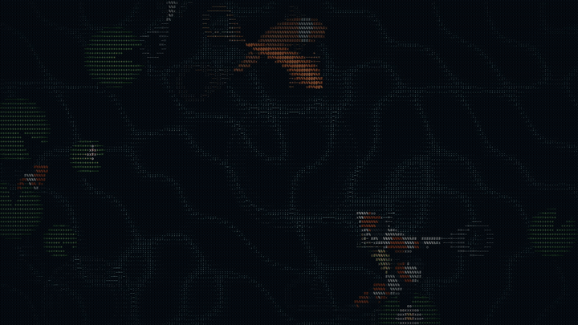

# ASCII Koi Pond Background

A seamlessly looping animated desktop wallpaper of a koi pond, rendered entirely
from monospace text characters. Koi swim on smooth closed paths, lily pads drift
on the surface, raindrop ripples spread across the water, and caustic light
patterns shimmer along the pond floor.



## Features

- **Seamless loop.** Every motion in the scene completes a whole number of cycles
  per loop, so the last frame flows directly into the first with no visible cut.
- **Eight koi varieties.** Kohaku, Sanke, Showa, Tancho, Ogon, Chagoi, Yamabuki
  and Asagi, each with procedurally generated markings.
- **Layered scene.** Water caustics, depth-tinted fish with cast shadows, animated
  pectoral and caudal fins, surface ripples, lily pads and lotus flowers.
- **Any resolution.** Render at 1080p, 1440p, 4K or ultrawide; the character grid
  scales with the output height.
- **Reproducible.** Each pond layout is determined by a seed, so a favorite pond
  can be re-rendered at any resolution.

## Download

A ready-to-use 1080p loop is attached to the
[latest release](../../releases/latest). To render a different resolution or
pond layout, build it from source as described below.

## Requirements

- Python 3.10 or newer
- [FFmpeg](https://ffmpeg.org/download.html) available on `PATH`

## Installation

```bash
git clone https://github.com/Javathan/ascii-koi-pond-background.git
cd ascii-koi-pond-background
python -m pip install -r requirements.txt
```

## Usage

Render the default 1080p, 30 second loop to `output/koi_pond_1080p.mp4`:

```bash
python render.py
```

Render a 4K loop:

```bash
python render.py --width 3840 --height 2160
```

Render a single frame for previewing a layout before committing to a full render:

```bash
python render.py --still preview.png --at 12
```

### Options

| Option        | Default            | Description                                           |
|---------------|--------------------|-------------------------------------------------------|
| `--width`     | `1920`             | Output width in pixels                                |
| `--height`    | `1080`             | Output height in pixels                               |
| `--fps`       | `30`               | Frames per second                                     |
| `--duration`  | `30`               | Loop length in seconds                                |
| `--cell`      | scales with height | Character cell size as `WxH`, for example `10x18`     |
| `--koi`       | `8`                | Number of fish                                        |
| `--pads`      | `7`                | Number of lily pads                                   |
| `--ripples`   | `7`                | Surface ripples per loop                              |
| `--seed`      | `7`                | Random seed that determines the pond layout           |
| `--font`      | system monospace   | Path to a monospace `.ttf` font                       |
| `--crf`       | `18`               | x264 quality factor; lower values mean higher quality |
| `-o`          | `output/...`       | Output video path                                     |

## Setting it as your wallpaper

**Windows.** Install [Lively Wallpaper](https://www.rocksdanister.com/lively/)
(free, open source, available from the Microsoft Store). Drag the rendered `.mp4`
into the Lively window and apply it to your display. Lively pauses playback
automatically while a full-screen application is running.

**macOS.** Use an application that supports video wallpapers, such as
[Plash](https://sindresorhus.com/plash) with a local video page, or a dedicated
video wallpaper utility.

**Linux.** Use [mpvpaper](https://github.com/GhostNaN/mpvpaper) on Wayland, or
`xwinwrap` with `mpv` on X11:

```bash
mpvpaper -o "loop no-audio" '*' output/koi_pond_1080p.mp4
```

## How it works

Each frame is evaluated on a grid of character cells rather than on pixels.
Scene layers write two values per cell: a luminance, which selects a glyph from a
density ramp (` .,:;-~=+*ox#%@`), and an RGB color, which tints that glyph.

1. **Water.** A sum of domain-warped sine fields produces a caustic network on
   the pond floor.
2. **Koi.** Each fish follows a closed curve built from a rotated ellipse with
   low-order harmonics. A spine of points is placed along the curve by arc length
   behind the head, and a travelling wave bends it to produce the swimming
   motion. Every cell near the fish is projected onto the spine to recover its
   position along the body and across it, which drives the body outline, fins,
   shading and color markings.
3. **Ripples and lily pads.** Expanding rings are added to the surface, and lily
   pads with optional lotus flowers are drawn last so fish pass beneath them.

Glyphs are pre-rendered once into an atlas. Composing a frame is then a single
array lookup followed by a color multiply, and frames are streamed directly into
FFmpeg as raw video.

## Project structure

```
.
├── koipond/
│   ├── glyphs.py    Font discovery and glyph atlas rendering
│   ├── koi.py       Fish motion, body geometry and varieties
│   └── scene.py     Water, ripples, lily pads and frame composition
├── docs/
│   └── preview.gif
├── render.py        Command line entry point
└── requirements.txt
```

## License

Released under the [MIT License](LICENSE).
